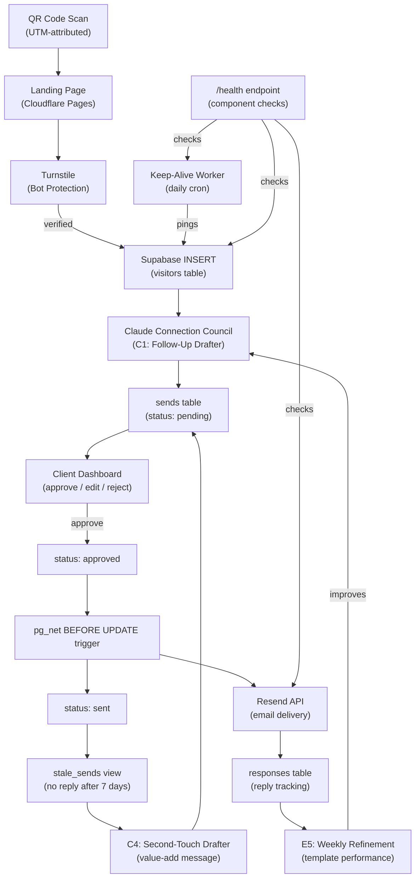

# System Architecture

Complete data-flow from QR scan to email delivery, including self-healing and second-touch paths.

## Key Paths

- **Main flow**: QR > Turnstile > Supabase > Claude drafts > Client approves > pg_net auto-sends > Resend delivers
- **Refinement loop**: Response data feeds E5 weekly, which improves Council drafting quality
- **Second touch**: Sends with no reply after 7 days get flagged, C4 drafts a value-add follow-up
- **Self-healing**: Keep-alive Worker prevents Supabase pause. Health endpoint monitors all components.
