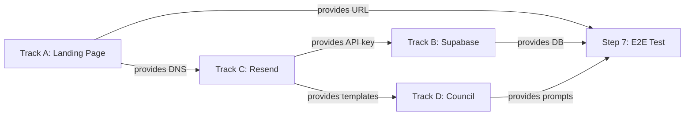

# Parallel Execution Plan

Four independent tracks converge at Step 7 (end-to-end test). Each track can be built by a separate Claude agent without blocking the others.

## Track A: Landing Page + Turnstile + Deploy

**Owner**: Agent A (Landing)
**Steps**: 2-3
**Deliverables**:

- Mobile-first HTML with Tailwind CSS
- Cloudflare Turnstile widget integrated
- Form wired to Supabase REST API with UTM capture
- Deployed to Cloudflare Pages with HTTPS
- Lighthouse mobile score 95+

**Dependencies**: Supabase project URL and anon key (from Track B)

## Track B: Supabase Schema + RLS + pg_net + Second-Touch

**Owner**: Agent B (Database)
**Step**: 4
**Deliverables**:

- Tables: visitors, events, sends, responses
- Row Level Security policies (anon INSERT only, authenticated reads own data)
- pg_net BEFORE UPDATE trigger for auto-send on approval
- stale_sends view for 7-day non-responder detection
- Multi-tenant indexing on client_id

**Dependencies**: Resend API key (from Track C) for the pg_net trigger

## Track C: Resend Setup + Template + Domain

**Owner**: Agent C (Email)
**Step**: 5
**Deliverables**:

- Sending domain verified (SPF + DKIM via Cloudflare DNS)
- CAN-SPAM compliant base template with EU AI Act Art 50 disclosure
- 4 category templates seeded in Obsidian vault
- Resend API key generated

**Dependencies**: Cloudflare DNS access (from Track A setup)

## Track D: Obsidian Vault + 25-Agent Council + Template Seeding

**Owner**: Agent D (Council)
**Step**: 6
**Deliverables**:

- Full vault structure (agents/, config/, templates/, runs/, refinement/)
- client-identity.yaml and brand-voice-register.md
- 25 agent prompt modules (A1-E5)
- Manual entry prompt for non-QR connections
- Template seeding with 4 category follow-ups

**Dependencies**: None (fully independent)

## Convergence: Step 7

All tracks merge for the end-to-end pipeline test:

1. QR scan hits Track A landing page
2. Form submits to Track B Supabase
3. Claude Council (Track D) drafts follow-up
4. Approval triggers pg_net (Track B) to call Resend (Track C)
5. 9-point compliance and health checklist validates everything

## Dependency Graph

